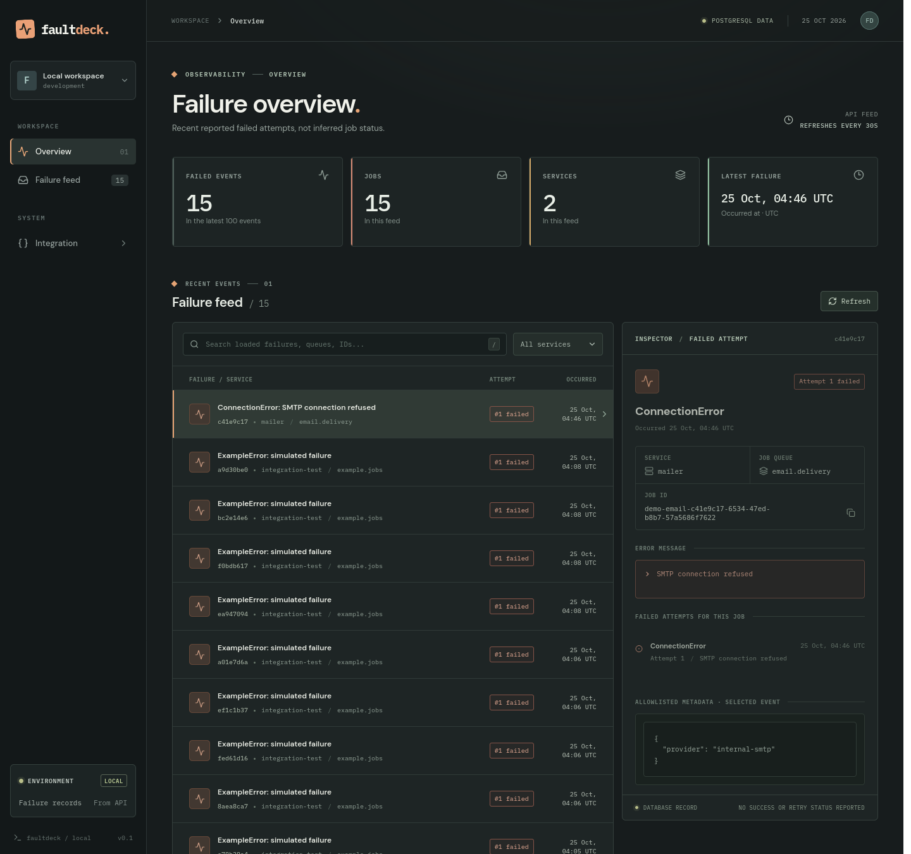
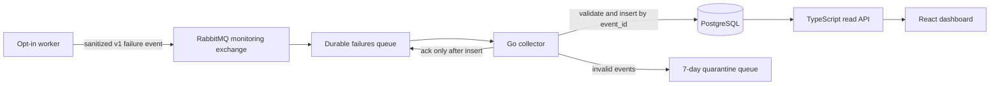

# FaultDeck

**Trace a failed RabbitMQ job from worker to dashboard.** FaultDeck is a self-hosted, opt-in failure monitor: a worker publishes a sanitized event, a Go collector stores it in PostgreSQL, and a TypeScript API serves a React dashboard. It does not read or interfere with application job queues.



*Screenshot from a running local stack (25 Oct 2026). The feed contains real PostgreSQL rows from the example worker and integration tests; the frontend has no bundled failure dataset.*

## Try it in a minute

Requires Docker with Compose. From the repository root:

```sh
docker compose up --build -d
docker compose --profile demo run --build --rm worker
```

Open **http://localhost:5173**, click **Refresh**, and select the new **ConnectionError: SMTP connection refused** row. The inspector shows its job ID, failed attempt history, error message, and allowlisted metadata. Each worker run publishes a new event, so existing rows are normal. To verify independently of the UI:

```sh
curl 'http://localhost:3001/api/failures?limit=1'
```

The returned `event_id` is the same failure you can inspect in the dashboard. Stop the stack with `docker compose down` (leave off `-v` to preserve database and broker data).

## How it works



The worker waits for RabbitMQ to confirm publication. The collector acknowledges a delivery **only after** PostgreSQL accepts the insert; if the database fails, the unacknowledged message can be redelivered. `event_id` is the primary key, so redelivery does not add a second row. Invalid messages are confirmed in a separate queue before the original is acknowledged. The [v1 event contract](contracts/README.md) defines the permitted fields and privacy rules.

The [integration test](tests/integration/reliability_test.go) checks that acknowledgement rule by holding a database insert open and observing RabbitMQ's unacknowledged message count. It also exercises duplicate delivery, collector restart, invalid-event quarantine, and database recovery. See the [test instructions below](#verify-delivery-reliability-local-development-only) before running it: it temporarily stops the local database.

## Current scope and limitations

- **Failed attempts only:** no success events, retry decisions, or trustworthy open/resolved job status. The dashboard does not invent those states.
- **Recent feed only:** the API returns at most 100 failures; dashboard search, filters, and counts cover only those loaded events, not all stored history. Job attempt history can be requested by job ID.
- **Local development security:** Compose binds its HTTP services to localhost and uses sample credentials. There is no authentication, TLS, or access-control layer. Do not expose this stack publicly as-is.
- **Opt-in reporting:** applications must publish a sanitized event themselves. FaultDeck does not discover arbitrary worker errors or consume application queues. Quarantined invalid bodies may contain secrets; restrict RabbitMQ management access (quarantined messages expire after seven days).

## Local development

### All services with Docker

For logs in the terminal instead of background mode:

```sh
docker compose up --build
```

Open http://localhost:5173 for the frontend, http://localhost:3001/health for the API, and http://localhost:15672 for RabbitMQ management (`faultdeck` / `faultdeck_dev`). PostgreSQL and RabbitMQ use persistent named volumes. Stop the stack with `docker compose down` (without `-v` to keep the data).

PostgreSQL is available from the host on port `15432` (the backend connects internally on port `5432`).

These are development-only credentials. A one-shot migration creates `failure_events` on startup, including for existing PostgreSQL volumes. The collector owns writes; the API reads from PostgreSQL but does not write to it. Images copy source at build time, so rebuild after editing code (`docker compose up --build`).

### Trigger and inspect one failed job

With the stack running, in another terminal:

```sh
docker compose --profile demo run --build --rm worker
docker compose exec postgres psql -U faultdeck -d faultdeck -c 'SELECT event_id, job_id, attempt, service, queue, error_category, error_message, occurred_at FROM failure_events ORDER BY stored_at DESC LIMIT 5;'
```

The worker simulates one failed email job, publishes a sanitized v1 event to the dedicated durable `faultdeck.failures` exchange/queue, waits for RabbitMQ's publish confirmation, and exits. Each run uses a fresh event ID; the collector inserts the row before acknowledging it. No application queues are consumed. Open http://localhost:5173 to see the real failure in the feed; select it to view that job's failed attempts and the selected event's metadata. Use **Refresh** or wait up to 30 seconds for a feed update.

The dashboard requests at most the latest 100 failed events. Search and service filters apply only to those loaded events; metrics count only that same window, not all history. The database has no success or retry-lifecycle events, so the UI does not claim jobs are open, retrying, or resolved. The feed and job history show loading, empty, and retryable error states.

Run `npm run test -w frontend` for dashboard loading, empty, populated, and API-error checks.

### Read failure records through the API

After triggering a worker failure, list the most recent events:

```sh
curl 'http://localhost:3001/api/failures?limit=5'
```

Copy a `job_id` from the response to request that job's failed attempts (URL-encode any special characters in the ID):

```sh
curl 'http://localhost:3001/api/jobs/PUT_JOB_ID_HERE/attempts'
```

`GET /api/failures` returns `{ "failures": [...] }`, newest `occurred_at` first, with a default limit of 20 (maximum 100). `GET /api/jobs/:jobId/attempts` returns `{ "job_id": "...", "attempts": [...] }` ordered by attempt number and time. Each record includes its event ID, job ID, attempt, service, queue, occurrence and storage times, sanitized error category/message, and allowlisted metadata. A missing job returns 404; bad parameters return 400; database errors return 503 without leaking database details to callers. These are **failed attempts only**: the API cannot claim that a job is still open, retrying, or resolved. The API is localhost-only in Compose and has no authentication; do not expose it publicly without access controls.

API tests (the second command requires running local Compose PostgreSQL and temporarily inserts then removes test rows):

```sh
npm run test -w backend
FAULTDECK_API_INTEGRATION=1 npm run test -w backend
```

### Verify delivery reliability (local development only)

With `docker compose up --build -d` already running:

```sh
go test ./...
FAULTDECK_INTEGRATION=1 go test ./tests/integration -count=1 -v
```

The opt-in integration test publishes a duplicate event, blocks a database insert to check the message stays unacknowledged, restarts the collector, quarantines an invalid event, and **temporarily stops and restarts the Compose PostgreSQL container** to check redelivery. Do not run it while other work depends on that local database. It restores PostgreSQL and the collector afterward; it does not remove persistent volumes or existing failure rows.

The collector accepts only v1 events matching the contract's fields and bounds. Invalid messages go to the durable `faultdeck.invalid` queue, with a reason header, after RabbitMQ confirms the quarantine copy; they are then acknowledged in the main queue. Quarantined bodies may contain sensitive data, so restrict RabbitMQ management access. They expire after seven days. A PostgreSQL write failure leaves the original message unacknowledged; the collector exits and Compose restarts it until the database is available. The event ID prevents a redelivery from creating another row. This is at-least-once handling, not a guarantee that publishers will never lose an event before RabbitMQ confirms it.

### Run the apps outside Docker

Requires Node.js and npm. Run PostgreSQL and the collector with Compose if you want the dashboard to show stored failures. Without a reachable PostgreSQL database the API serves `/health` but failure requests show an error state.

```sh
npm install
npm run dev
```

The frontend runs at http://localhost:5173 and proxies `/api` requests to http://localhost:3001 when run outside Compose. In Compose the proxy targets the backend container. The API health endpoint is at http://localhost:3001/health. Run `npm run build` to build both workspaces.
